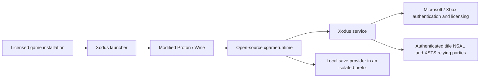

# MSFS 2024 Linux – Experimental First Playable Milestone

An experimental community compatibility project by **OnlyCrayZ-Labs** for the
Microsoft Store / Xbox PC edition of Microsoft Flight Simulator 2024 on Linux.

**User-reported first playable milestone:** the Microsoft Store / Xbox PC
version was launched and tested in a flight with a standard MSFS 2024 aircraft
on CachyOS Linux with an NVIDIA RTX 5090, using Xodus and a
modified Wine/Proton runtime. The recorded setup also reached the menu/world map
and demonstrated cockpit and landscape rendering, working instruments and
user input in the observed test.
Long-term stability, restart persistence and reproducible installation from a
clean checkout have not been validated. This observation concerns the preserved
private checkpoint; sanitized public source revisions need separate validation.

> Experimental source code and documentation preview. This is not a supported
> installer or a verified binary runtime release. Clean installation remains
> unvalidated.

## Status

| Area | Status |
| --- | --- |
| Real Microsoft/Xbox authentication | Working in the recorded manual milestone |
| First-time setup, profile, menu and world map | User-confirmed |
| Flight with a standard MSFS 2024 aircraft; cockpit, landscape, instruments and user input | User-confirmed on CachyOS / NVIDIA RTX 5090 |
| Title-specific NSAL / backend authorization | Implemented; metadata shows successful token calls and backend responses |
| Local game saves | Local provider; write operations observed; restart/restore testing pending |
| Xbox cloud-save synchronization | Not implemented |
| Marketplace product queries and gamer pictures | Incomplete |
| Long-flight stability and performance | Not yet characterized |
| Fenix A320, Navigraph, BeyondATC | Not tested; no compatibility claim |
| Other third-party add-ons, including iniBuilds | Not validated |

## Screenshots

Verified screenshots are pending selection and privacy review. We will add real
captures of the main menu, world map and runway cockpit. No images are included
in this draft: screenshots were not supplied for the recorded milestone, and
metadata logs cannot establish what was rendered. See the [image checklist](assets/screenshots/README.md).

## How it works



The critical authentication fix loads the title-specific endpoint list after
SISU sign-in, combines it with Microsoft's default endpoints, and chooses the
most specific matching host. MSFS service hosts use
`rp://msfsservices.msgamestudios.com/`; title PlayFab subdomains use
`rp://msfsplayfabapi.com/`. Signing policy follows the selected endpoint.
This removes the previous empty-token path that stalled the tested game at 3/19.
No token, signature, license blob or private account record is included here.

## Repositories

| Repository | Responsibility / upstream |
| --- | --- |
| [MSFS2024-Linux](https://github.com/OnlyCrayZ-Labs/MSFS2024-Linux) | Project overview, issue intake, tested-version manifests and public guides |
| [xodus](https://github.com/OnlyCrayZ-Labs/xodus) | Authentication/licensing service; derived from xodus-gaming/xodus |
| [xodus-proton](https://github.com/OnlyCrayZ-Labs/xodus-proton) | Source integration manifest with pinned Wine; references xodus-gaming/Proton without redistributing its SDK sources |
| [wine](https://github.com/OnlyCrayZ-Labs/wine) | Wine integration; derived from xodus-gaming/wine |
| [xgameruntime](https://github.com/OnlyCrayZ-Labs/xgameruntime) | Open-source GDK-compatible runtime; derived from xodus-gaming/xgameruntime |

This hub is the project homepage; a separate website is unnecessary for the
first source release. Ownership and credit remain with all original authors.

## Installation and development

There is **no validated clean-machine end-user installation procedure yet**.
See [installation status](INSTALLATION.md) and [milestone release notes](RELEASE-NOTES.md).
The xodus-proton repository is a source integration manifest, not a complete
Proton source checkout. Its recursive clone fetches selected Wine/xgameruntime
sources; a complete Proton build still requires separately obtained upstream
sources and a review of their SDK terms.
The working milestone uses a preserved runtime and isolated trial rather than
an installer reproducible from the current public source alone. Do not assume
that cloning the repositories or running upstream `make install` reproduces it.

After publication and anonymous submodule-clone validation, source acquisition
will use:

```sh
git clone https://github.com/OnlyCrayZ-Labs/xodus.git
git clone --recurse-submodules https://github.com/OnlyCrayZ-Labs/xodus-proton.git
```

Developer requirements include Rust meeting the repository-declared minimum
version (1.98.0), Linux development packages needed by Xodus, and the pinned
Proton SDK/build dependencies from upstream. Build in a new target directory:

```sh
cd xodus
CARGO_TARGET_DIR=target-msfs-development cargo build --locked -p xodus-service
CARGO_TARGET_DIR=target-msfs-development cargo test --locked -p xodus-service
```

These are service build/test commands, not an automatic game installer. Do not
run ignored account tests in public CI. A release-specific build guide must
still validate the full Wine/Proton build, title configuration, normal licensing,
private prefix setup and manual launch workflow on a clean environment.
Never overwrite a working prefix/build, and back up local saves before testing.

You must supply your own legitimately licensed game installation and account.
Game files, Microsoft redistributables, credentials, saved-game backups and
private trial binaries are not distributed by this source project.

## Evidence and limitations

The first run's metadata records 22 successful token API sequences and backend
HTTP 200 responses; visible flight behavior is the user's report. Local save
writes succeeded, but cloud sync and persistence across a restart were not
validated. Remaining issues include unimplemented Store product queries and
gamer pictures, late async errors, transfer errors and world-content HTTP 404s.
No FPS measurements, completed end-to-end flight, multiplayer session or Marketplace purchase is claimed.

## Roadmap

1. Reproducible clean source build and installation documentation.
2. Stability/performance measurements and less intrusive diagnostics.
3. Longer flights and settings/save persistence across normal restart.
4. Xbox Live and Marketplace compatibility.
5. Fenix A320, Navigraph, BeyondATC and other aircraft, including iniBuilds.

## Contributing and governance

Please report non-sensitive reproducible issues here. Code changes belong in
the relevant component repository and go through pull requests. Read
[CONTRIBUTING.md](CONTRIBUTING.md) and [SECURITY.md](SECURITY.md).
**OnlyCrayZ maintains the official development branches and authorizes official
releases.** Other contributors retain the rights granted by the applicable
open-source licenses; this governance does not prevent lawful independent forks.

## Licensing and attribution

The original documentation in this hub is licensed under **GPL-3.0-only**. Component licenses remain separate: Xodus
GPLv3, Wine/xgameruntime LGPL 2.1 with per-file later-version grants, and Proton's
top-level BSD-style license plus its components' own licenses. See
[LICENSING.md](LICENSING.md). No single hub license relicenses those components.

Thanks to xodus-gaming, Wine, Valve/Proton and all dependency contributors.
Microsoft Flight Simulator, Xbox and Microsoft are their owners' trademarks.
This is an independent community project, not an official Microsoft, Asobo,
Valve or upstream Xodus release or endorsement.
